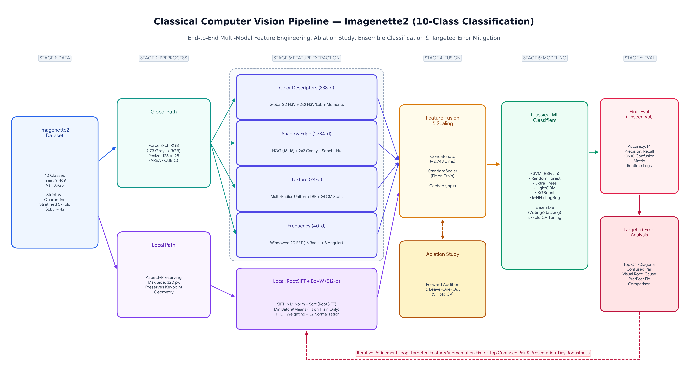

# Classical Computer Vision Pipeline for Imagenette Classification


An end-to-end **classical computer vision** and traditional machine learning pipeline for 10-class image classification on the **Imagenette2** dataset—built strictly without deep neural networks (no CNNs, ViTs, or pretrained deep feature extractors).

**Course:** Machine Vision (Fall 2026) — Amirkabir University of Technology (Tehran Polytechnic)  
**Instructor:** Dr. Shariatmadar Mortazavi  
**Author:** Kasra Adimi (`40123006`)

---

## Pipeline Architecture

<!-- Replace the path below if you store the diagram in a different folder -->
<p align="center">
  
</p>

> **Zero Data Leakage Policy:** The default `val` split (`3,925` images) is strictly quarantined for final evaluation only. All EDA, visual vocabulary clustering (`MiniBatchKMeans`), TF-IDF fitting, feature scaling, ablation studies, and hyperparameter tuning are conducted exclusively within the `train` split (`9,469` images) using deterministic **Stratified 5-Fold Cross-Validation** (`SEED = 42`).

---

## Dataset Summary (Imagenette2)

* **Classes (10):** Tench, English Springer, Cassette Player, Chain Saw, Church, French Horn, Garbage Truck, Gas Pump, Golf Ball, Parachute.
* **Splits:** `9,469` Training images | `3,925` Validation images (`0` corrupted files).
* **EDA Insights Handled in Preprocessing:**
  * **Grayscale Standardization:** `173` single-channel grayscale images in `train` are automatically loaded as 3-channel RGB (`cv2.IMREAD_COLOR`) to ensure color-space compatibility.
  * **Dual Resizing:** Resolutions span from `50×27` up to `4288×4368` (median `500×375`). We use a fixed `128×128` path for global descriptors and an aspect-ratio-preserving path (longest side $\le 320$ px) for local keypoints.

---

## Multi-Modal Feature Engineering (`2,748` Total Dimensions)

| Feature Family | Descriptors & Configuration | Dimensions | Target Visual Cues |
| :--- | :--- | :---: | :--- |
| **Color** | Global 3D HSV histogram (`8×4×4`), spatial `2×2` HSV & CIELAB histograms, Color Moments (mean, std, skew) | `338` | Dominant palettes & spatial color layout (e.g., sky, grass, brass) |
| **Shape & Edge** | HOG (`16×16` cells, `2×2` blocks, `9` orientations), spatial `2×2` Canny density, Sobel orientation histogram, log Hu Moments | `1,784` | Geometric structures & strong vertical/horizontal lines |
| **Texture** | Multi-radius rotation-invariant Uniform LBP (`(8,1)`, `(16,2)`, `(24,3)`) + multi-distance GLCM stats | `74` | Surface patterns (dimples, fur, stone, foliage) |
| **Frequency** | Windowed 2D FFT log-magnitude spectrum (`16` radial rings + `8` angular wedges) | `40` | Periodic patterns & background clutter energy |
| **Local (BoVW)** | **RootSIFT** ($\le 300$ keypoints/img) + `MiniBatchKMeans` ($K=512$, train-only) + Sublinear TF-IDF + $L_2$ norm | `512` | Scale- & rotation-invariant local object parts |
| **Total Fused** | Concatenated multi-modal feature vector | **`2,748`** | Comprehensive classical representation |

---

## Hardware & Runtime Benchmarks

* **OS & Python:** Linux (`7.0.0-43-generic`) | Python `3.12.3`
* **Hardware:** `x86_64` CPU (4 Physical Cores / 8 Logical Threads) | `15.32 GB` RAM

| Pipeline Stage | Train Time (`9,469` imgs) | Val Time (`3,925` imgs) | Notes |
| :--- | :---: | :---: | :--- |
| **Global Feature Extraction** (Color, Shape, Texture, Freq) | `107.76 s` | `54.94 s` | Parallelized across 8 threads (`joblib`) |
| **Local Feature Extraction** (RootSIFT + BoVW + TF-IDF) | `100.10 s` | `55.36 s` | `2,446,896` train descriptors; K-Means fit on `300k` |
| **Classifier Training & Evaluation** | *TBD* | *TBD* | Updated after Phase 4 & 5 |

---

## Project Roadmap

- [x] **Phase 1:** Environment setup, global seed fixing (`SEED=42`), hardware logging, and EDA.
- [x] **Phase 2A:** Dual preprocessing, Stratified 5-Fold CV setup, and parallel Global Feature Extraction.
- [x] **Phase 2B:** RootSIFT extraction, train-only K-Means visual vocabulary ($K=512$), and TF-IDF BoVW encoding.
- [ ] **Phase 3:** Feature Fusion, scaling, and Ablation Study (Forward Addition & Leave-One-Out).
- [ ] **Phase 4:** Classical ML classifier benchmarking (SVM, RF, ExtraTrees, LightGBM, XGBoost, k-NN) & Ensembling.
- [ ] **Phase 5:** Final evaluation on `val`, 10×10 Confusion Matrix, targeted off-diagonal error mitigation, and robustness stress-testing.
- [ ] **Phase 6:** Final notebook polish (`HW1_40123006.ipynb`) and LaTeX technical report (`HW1_40123006.pdf`).

---

## Repository Structure

```text
imagenette-classical-cv/
├── assets/
│   └── classical_cv_pipeline_scheme.png   # High-res pipeline architecture diagram
├── Report/                                # LaTeX report sources & final PDF
├── vision_project_one.ipynb               # Self-contained end-to-end Jupyter Notebook
├── phase1_analysis.md                     # Detailed EDA findings & robustness checklist
├── .gitignore                             # Excludes dataset/, cache/, and venv/
└── README.md
```

---

## Quick Start

1. **Clone the repository and create a virtual environment:**
   ```bash
   git clone https://github.com/KasraKra/imagenette-classical-cv.git
   cd imagenette-classical-cv
   python3 -m venv project01_venv
   source project01_venv/bin/activate
   ```

2. **Install dependencies:**
   ```bash
   pip install numpy pandas matplotlib seaborn scikit-learn scikit-image opencv-python-headless lightgbm xgboost tqdm psutil joblib
   ```

3. **Prepare the dataset:**
   Download `imagenette2.tgz` and extract it to `dataset/imagenette2/` (so `train/` and `val/` sit directly inside `dataset/imagenette2/`).

4. **Run the notebook:**
   Open `vision_project_one.ipynb` and run cells sequentially. Extracted features are automatically cached in `cache/` as `.npz` files for fast experimentation.

---

## Key Academic References

* **RootSIFT:** Arandjelović, R., & Zisserman, A. (2012). *Three things everyone should know to improve object retrieval.* IEEE CVPR.
* **HOG:** Dalal, N., & Triggs, B. (2005). *Histograms of oriented gradients for human detection.* IEEE CVPR.
* **Uniform LBP:** Ojala, T., Pietikäinen, M., & Mäenpää, T. (2002). *Multiresolution gray-scale and rotation invariant texture classification with local binary patterns.* IEEE TPAMI.